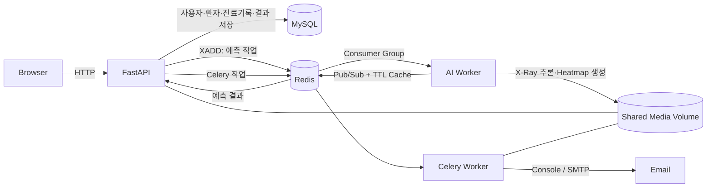

# AI 폐렴 판독 지원 백오피스

흉부 X-Ray와 AI 모델을 활용해 폐렴 예측을 지원하고, 사용자·환자·진료기록·예측 결과를 한곳에서 관리하는 의료진용 백오피스입니다.

> 이 프로젝트의 AI 결과는 의료진의 판단을 돕기 위한 참고 정보이며 실제 진단을 대체하지 않습니다.

## 프로젝트 소개

의료진이 환자와 진료기록을 관리하면서 X-Ray 기반 폐렴 예측 결과와 Grad-CAM Heatmap을 확인할 수 있도록 구현했습니다. 시간이 오래 걸리는 AI 추론과 이메일 전송은 API 서버에서 분리하고, Redis와 독립 Worker를 이용해 처리합니다.

현재 저장소는 로컬 개발 및 팀 통합 테스트를 위한 Docker Compose 환경을 제공합니다.

| 구분 | 내용 |
| --- | --- |
| 주요 사용자 | 의료진, 개발실, 연구진, 관리자 |
| 핵심 기능 | 회원·권한 관리, 환자 관리, 진료기록 및 X-Ray 관리, AI 폐렴 예측, 결과 이메일 전송 |
| API 서버 | FastAPI, SQLAlchemy AsyncSession |
| 비동기 처리 | Redis Streams, Redis Pub/Sub, Celery |
| 데이터 저장 | MySQL, Docker Named Volume |
| 실행 환경 | Python 3.13, Docker Compose |

## 주요 화면

| 환자 목록 | AI 예측 결과 |
| --- | --- |
|  |  |

더 많은 화면과 연결 API는 [앱 실행 화면 문서](./docs/7일차_앱_실행화면.md)에서 확인할 수 있습니다.

## 주요 기능

### 사용자와 권한

- 이메일·비밀번호 기반 회원가입 및 로그인
- JWT Access Token과 HttpOnly Refresh Token을 이용한 인증
- 내 정보 수정, 비밀번호 변경, 로그아웃, 회원 탈퇴
- 관리자용 회원 검색·필터링 및 역할 변경
- `PENDING`, `STAFF`, `ADMIN` 역할과 `MEDICAL`, `DEV`, `RESEARCH` 부서 조합에 따른 접근 제어

### 환자와 진료기록

- 환자 등록, 목록 검색, 성별·나이 필터, 상세 조회, 수정 및 삭제
- 차트 번호, 증상, 촬영 일시와 흉부 X-Ray를 포함한 진료기록 등록
- 진료기록 목록·상세 조회 및 X-Ray 미리보기
- 환자 삭제 시 연결된 기록과 미디어 파일을 함께 정리하는 일관성 처리

### AI 폐렴 예측

- 진료기록의 최신 X-Ray를 이용한 폐렴 여부 및 신뢰도 예측
- `model_1`, `model_3` 추론 모델 선택
- 예측에 활용된 X-Ray, 모델, 생성 시점 및 Grad-CAM Heatmap 저장
- 기존 결과와 Heatmap이 유효하면 재추론 없이 캐시된 DB 결과 반환
- 동일 X-Ray·모델 조합의 중복 추론과 중복 저장 방지

### 이메일 백그라운드 작업

- AI 결과와 Heatmap을 환자 이메일로 전송
- Celery 전용 `email_queue`에서 HTTP 요청과 분리해 처리
- `PENDING`, `STARTED`, `SUCCESS`, `RETRY`, `FAILURE` 상태 기록
- 전송 실패 시 60초 간격, 최대 3회 재시도
- 개발 환경의 콘솔 전송과 운영 환경의 SMTP 전송 지원

## 아키텍처



| 구성 요소 | 책임 |
| --- | --- |
| FastAPI | HTTP 요청, 인증·인가, 데이터 검증, AI 작업 발행, 예측 결과 영속화 |
| AI Worker | Redis Stream 소비, X-Ray 전처리, 모델 추론, Heatmap 생성 |
| Celery Worker | 이메일 생성·전송, 재시도, 작업 상태 갱신 |
| Redis | AI 작업 큐, Consumer Group, Pub/Sub, TTL 결과 캐시, 분산 락, Celery Broker·Backend |
| MySQL | 사용자, 환자, 진료기록, X-Ray, AI 분석 결과, 이메일 작업 저장 |
| Shared Media Volume | FastAPI와 Worker 사이에서 X-Ray 원본과 Heatmap 공유 |

### AI 추론 처리 흐름

1. FastAPI가 JWT, 역할·부서, 진료기록과 최신 X-Ray를 검증합니다.
2. 동일한 `xray_image_id + ai_model`의 유효한 결과가 있으면 즉시 재사용합니다.
3. 신규 추론이면 결과 채널을 먼저 구독하고 Redis 분산 락을 획득합니다.
4. 락을 획득한 요청만 `prediction:tasks` Stream에 작업을 등록합니다.
5. AI Worker가 Consumer Group으로 작업을 가져와 추론과 Heatmap 생성을 수행합니다.
6. Worker는 결과를 TTL 캐시에 저장하고 Pub/Sub으로 발행한 뒤 작업을 ACK합니다.
7. FastAPI가 결과를 검증해 MySQL에 저장하고 락을 해제한 후 `200 OK`를 반환합니다.

현재 예측 API는 작업 접수 직후 `202 Accepted`를 반환하는 방식이 아닙니다. FastAPI가 Worker 결과를 기다린 뒤 최종 예측 결과를 응답합니다.

### 동시성과 장애 복구

- `SET NX EX` 분산 락으로 동일 이미지·모델의 중복 작업 등록을 방지합니다.
- 락 소유자 ID를 확인하는 Lua 스크립트로 다른 요청의 락이 삭제되지 않게 합니다.
- Pub/Sub 알림을 놓쳐도 TTL 결과 캐시를 재조회합니다.
- 장시간 Pending 상태인 작업은 `XAUTOCLAIM`으로 다른 Worker가 회수합니다.
- Worker는 정상 처리된 작업만 `XACK`하고, `SIGTERM`·`SIGINT` 수신 시 연결을 정리합니다.
- DB의 `xray_image_id + ai_model` Unique Constraint가 중복 결과 저장을 최종 방어합니다.

자세한 내용은 [이벤트 기반 처리 문서](./docs/폐렴예측_Event_Driven_프로세스.html)와 [Docker 인프라 문서](./docs/프로젝트_아키텍처_Docker_인프라.md)를 참고하세요.

## AI 모델 평가

`model_1`은 DenseNet121, ConvNeXt-Tiny, EfficientNet-B3의 가중 앙상블입니다.

| 항목 | 결과 |
| --- | ---: |
| 평가 방식 | 5-fold OOF 검증 |
| 평가 표본 | 5,216개 |
| Threshold | 0.36 |
| Recall | 0.9956 |
| Accuracy | 0.9931 |
| F1-score | 0.9954 |
| AUROC | 0.9995 |

```bash
uv run python -m worker.models.model_1.evaluate
uv run python -m worker.models.model_1.evaluate --json
```

위 수치는 독립 테스트셋이 아닌 OOF 내부 검증 결과입니다. 실제 임상 성능이나 외부 데이터에 대한 일반화 성능을 의미하지 않으며, Grad-CAM도 병변 위치를 확정하는 진단 결과가 아닙니다. 자세한 혼동행렬과 평가 조건은 [모델 평가 보고서](./reports/model_evaluation.md)를 확인하세요.

## 기술 스택

| 영역 | 기술 |
| --- | --- |
| Frontend | HTML, CSS, Vanilla JavaScript |
| Backend | FastAPI, Pydantic, SQLAlchemy 2.0 AsyncIO |
| Authentication | JWT, HttpOnly Cookie, Argon2 |
| Database | MySQL 8.0, Alembic |
| AI | PyTorch, torchvision, OpenCV, Pillow |
| Messaging | Redis Streams, Consumer Group, Pub/Sub |
| Background Job | Celery |
| Infrastructure | Docker, Docker Compose, uv |
| Performance Test | Locust |

## 디렉터리 구조

```text
.
├── app/
│   ├── apis/               # FastAPI 라우터
│   ├── core/               # 설정, 인증·인가, DB, Redis, 성능 미들웨어
│   ├── models/             # SQLAlchemy ORM 모델
│   ├── repositories/       # 데이터 접근 계층
│   ├── schemas/            # 요청·응답 스키마
│   ├── services/           # 비즈니스 로직
│   ├── celery_worker.py    # Celery 설정
│   ├── tasks.py            # 이메일 백그라운드 작업
│   └── main.py             # FastAPI 진입점
├── worker/
│   ├── models/             # AI 모델과 체크포인트
│   ├── predictors/         # 모델별 추론 어댑터
│   └── main.py             # Redis Stream AI Worker
├── static/                 # SPA 화면, 스타일, API 클라이언트
├── alembic/                # DB 마이그레이션
├── mysql/                  # MySQL 문자셋 설정
├── tests/performance/      # Locust 시나리오
├── reports/                # 모델·성능 평가 결과
├── docs/                   # 설계와 개발 과정 문서
├── docker-compose.yml
├── pyproject.toml
└── uv.lock
```

## 시작하기

### 사전 요구사항

- Docker와 Docker Compose
- 로컬에서 Python 명령을 실행할 경우 Python 3.13과 [uv](https://docs.astral.sh/uv/)

### 1. 환경 변수 설정

프로젝트 루트에 `.env`를 생성합니다.

```dotenv
DB_USER=root
DB_PASSWORD=change-me
DB_NAME=ai_health

JWT_SECRET_KEY=replace-with-a-long-random-secret
JWT_ALGORITHM=HS256
ACCESS_TOKEN_EXPIRE_MINUTES=30
REFRESH_TOKEN_EXPIRE_DAYS=7

EMAIL_DELIVERY_MODE=console
```

Docker Compose가 `DB_HOST`, `DB_PORT`, Redis 및 Celery 연결 주소를 컨테이너 환경에 주입합니다. 실제 이메일 전송이 필요하면 다음 값을 추가하세요.

```dotenv
EMAIL_DELIVERY_MODE=smtp
SMTP_HOST=smtp.example.com
SMTP_PORT=587
SMTP_USER=your-user
SMTP_PASSWORD=your-password
SMTP_FROM_EMAIL=noreply@example.com
SMTP_USE_TLS=true
```

비밀값이 포함된 `.env`는 Git에 커밋하지 마세요.

### 2. 서비스 실행

```bash
docker compose up --build -d
docker compose ps
```

### 3. 데이터베이스 마이그레이션

```bash
docker compose exec fastapi alembic upgrade head
docker compose exec fastapi alembic current
```

### 4. 접속

| 서비스 | 주소 |
| --- | --- |
| Web | <http://localhost:8000> |
| Swagger UI | <http://localhost:8000/docs> |
| Health Check | <http://localhost:8000/healthcheck> |
| MySQL | `localhost:3307` |
| Redis | `localhost:6379` |

회원가입한 계정의 초기 역할은 `PENDING`입니다. 보호된 기능을 확인하려면 기존 관리자가 역할을 `STAFF` 또는 `ADMIN`으로 승인해야 합니다.

최초 관리자 계정이 없는 로컬 개발 환경에서는 회원가입 후 MySQL에 접속해 해당 계정을 한 번만 승격할 수 있습니다.

```bash
docker compose exec mysql mysql -uroot -p
```

```sql
USE ai_health;
UPDATE users SET role = 'ADMIN' WHERE email = 'admin@example.com';
```

위 SQL의 이메일은 실제 가입한 계정으로 변경하세요. 운영 환경에서는 직접 SQL을 실행하는 대신 별도의 안전한 초기 관리자 생성 절차를 두는 것이 좋습니다.

### 5. 로그와 종료

```bash
docker compose logs -f fastapi ai-worker celery_worker
docker compose down
```

DB와 Redis 데이터를 포함한 Named Volume까지 삭제하려면 `docker compose down -v`를 사용하세요. 이 명령은 저장된 데이터와 미디어를 제거하므로 주의가 필요합니다.

### AI Worker 확장

Consumer Group을 이용해 여러 Worker에 작업을 분산할 수 있습니다.

```bash
docker compose up --build -d --scale ai-worker=2
```

## 주요 API

전체 요청·응답 스키마는 실행 후 Swagger UI에서 확인할 수 있습니다.

| 영역 | Method | Endpoint | 설명 |
| --- | --- | --- | --- |
| 사용자 | `POST` | `/user_api/v1/users` | 회원가입 |
| 사용자 | `GET` | `/user_api/v1/users` | 회원 목록 조회 |
| 사용자 | `PATCH` | `/user_api/v1/users/{user_id}/role` | 회원 역할 변경 |
| 인증 | `POST` | `/auth_api/v1/auth/login/` | 로그인 |
| 인증 | `POST` | `/auth_api/v1/auth/refresh/` | Access Token 갱신 |
| 인증 | `POST` | `/auth_api/v1/auth/logout/` | 로그아웃 |
| 마이페이지 | `GET` | `/mypage_api/v1/users/me` | 내 정보 조회 |
| 환자 | `POST`, `GET` | `/patient_api/v1/patients/` | 환자 등록·목록 조회 |
| 환자 | `GET`, `PATCH`, `DELETE` | `/patient_api/v1/patients/{patient_id}` | 환자 상세·수정·삭제 |
| 진료기록 | `POST` | `/record_api/v1/record/{patient_id}` | X-Ray 포함 진료기록 등록 |
| 진료기록 | `GET` | `/record_api/v1/records/{record_id}` | 진료기록 상세 조회 |
| AI 예측 | `POST` | `/prediction_api/v1/medical-records/{record_id}/predict` | 폐렴 예측 실행 |
| AI 예측 | `GET` | `/prediction_api/v1/medical-records/{record_id}/analyses` | 저장된 결과 조회 |
| 이메일 | `POST` | `/email_api/v1/medical-records/{record_id}/email-jobs` | 결과 이메일 작업 생성 |
| 이메일 | `GET` | `/email_api/v1/email-jobs/{email_job_id}` | 이메일 작업 상태 조회 |

## 검증과 QA

사용자·인증 API는 로컬 환경에서 동시 사용자 100명, 초당 10명 증가, 주요 시나리오별 10분 조건으로 Locust 부하 테스트를 진행했습니다.

| 기준 | 목표 | 측정 결과 |
| --- | ---: | ---: |
| 최대 API별 p95 | 3,000ms 이하 | 420ms |
| 성공률 | 99% 이상 | 100% |
| HTTP 5xx 오류율 | 1% 미만 | 0% |

이는 2026-07-17 로컬 개발 환경 측정값이며 운영 환경의 성능을 보장하지 않습니다. 세부 조건과 원본 CSV는 [성능 테스트 보고서](./docs/NFR-USER-003_성능_테스트_결과.md)와 `reports/performance/`에서 확인할 수 있습니다.

배포 전에는 다음 항목을 확인합니다.

- 모든 컨테이너와 Health Check가 정상인지
- Alembic이 최신 Head를 가리키는지
- 회원가입·로그인과 역할별 접근 제어가 동작하는지
- 환자·진료기록 CRUD와 X-Ray 업로드가 동작하는지
- AI 예측, 중복 예측 방지, Heatmap 저장이 동작하는지
- 이메일 작업 상태와 실패 재시도가 기록되는지
- MySQL, Redis, Worker 장애 상황에서 오류가 적절히 처리되는지

## 개발 방식

작업은 GitHub Issue를 기준으로 정의하고 `feature/이슈번호` 브랜치에서 개발한 뒤 Pull Request 검토를 거쳐 `main`에 병합했습니다. 하나의 브랜치에는 하나의 작업 목적만 담고, 구현 내용·테스트 결과·관련 Issue를 PR에 기록하는 규칙을 사용했습니다.

프로젝트의 요구사항 정의부터 API 설계, 아키텍처 적용, Docker 인프라와 QA까지의 과정은 `docs/`에 정리되어 있습니다.

## 배포 범위와 향후 과제

현재 구현·검증된 범위는 Docker Compose 기반 로컬 환경입니다. AWS 구성은 아직 배포 완료 상태가 아닌 설계안이며, 운영 전 다음 작업이 필요합니다.

- FastAPI, AI Worker, Celery Worker를 ECS 서비스로 분리
- MySQL을 RDS, Redis를 ElastiCache, 미디어를 S3 또는 EFS로 이전
- ALB·ACM·CloudFront를 이용한 HTTPS와 Private Subnet 구성
- Secrets Manager 기반 비밀값 관리
- Alembic 일회성 배포 Task와 실패 시 롤백 절차 구성
- CloudWatch 로그·지표·알람 및 Worker 적체 모니터링
- 운영용 Uvicorn 설정, Readiness Check, Redis 인증과 네트워크 접근 제한
