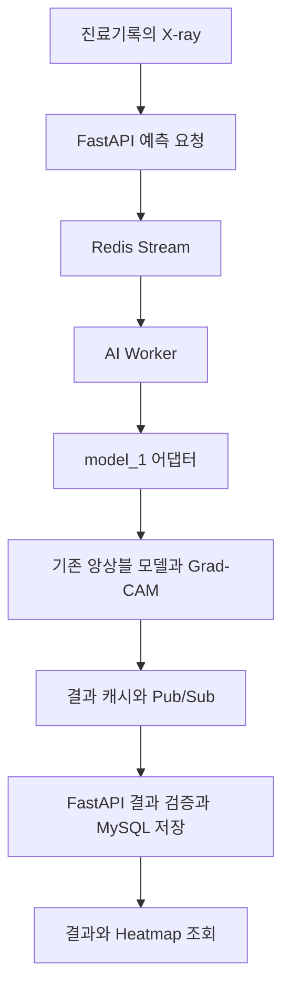

# AI 폐렴 판독 지원 백오피스

**개인 X-ray 프로젝트의 최종 앙상블 모델을 환자·진료기록 관리 웹 서비스의 예측 기능으로 연결한 팀 프로젝트입니다.**

웹 서비스 개발을 배우며 모델 추론뿐 아니라 예측 결과 저장·조회, 사용자·환자 API와 로컬 성능 점검까지 경험을 확장했습니다.

[포트폴리오 상세 사례](https://hyunwoo-jung-portfolio.vercel.app/case-studies/pneumonia-backoffice) · [개인 X-ray 모델 개발 프로젝트](https://github.com/ceohwj/chest-xray-pneumonia-classification-ai) · [팀 원본 저장소](https://github.com/kimeunmi82/Oz_codingSchool)

| 구분 | 내용 |
| --- | --- |
| 프로젝트 | 오즈코딩스쿨 웹 서비스 학습 팀 프로젝트 |
| 개발 기록 | 2026.07 · 공개 GitHub 기록 기준 |
| 개인 담당 | X-ray 모델 제공·예측 API·Grad-CAM 연동, X-ray DB 모델, 비밀번호 변경·환자 수정/삭제 API, 로컬 부하 테스트 |
| 모델 연결 | 개인 프로젝트의 최종 제출 모델 → 서비스의 `model_1` → 진료기록별 예측 결과·Heatmap 저장/조회 |
| 실행 범위 | Docker Compose 기반 로컬 개발 환경 · AWS는 향후 설계 |

이 저장소는 팀 원본의 포크이며, 아래 개인 기여는 **정현우(`ceohwj`)가 작성·병합한 원본 PR**을 근거로 정리했습니다. 전체 백오피스는 팀 결과물입니다. AI 결과는 학습용 참고 정보이며 실제 진단을 대체하지 않습니다.

## 문제 정의: 모델 출력을 진료기록에 연결하기

이미지 한 장의 분류 결과를 계산하는 것과 웹 서비스에서 그 결과를 사용하는 것은 다른 작업입니다. 환자와 진료기록에 X-ray를 연결하고, 예측에 사용한 이미지·모델·결과·Heatmap을 함께 저장해 다시 조회할 수 있어야 했습니다.

이 프로젝트에서는 기존 모델을 서비스에 적용하고, 그 예측 결과가 사용자 화면까지 이어지도록 API와 데이터 구조를 연결했습니다.

## 개인 담당 역할과 근거

| 영역 | 직접 수행한 작업 | 원본 PR |
| --- | --- | --- |
| **X-ray 모델·서비스 연동** | 최종 앙상블 모델 제공, 폐렴 예측 실행과 결과 저장·조회 API, Grad-CAM 생성 및 결과 화면 연동 | [#68](https://github.com/kimeunmi82/Oz_codingSchool/pull/68) |
| **모델 평가** | 저장된 OOF 혼동행렬로 Recall·Accuracy를 재계산하는 스크립트와 평가 보고서 | [#69](https://github.com/kimeunmi82/Oz_codingSchool/pull/69) |
| **X-ray 데이터 구조** | 진료기록·업로더 관계, 이미지 URL·촬영 일시·인덱스를 포함한 ORM 모델 정의 | [#17](https://github.com/kimeunmi82/Oz_codingSchool/pull/17) |
| **환자 관리 API** | 환자 정보 수정·삭제, 관련 데이터·파일 정리와 오류 시 rollback 처리 | [#55](https://github.com/kimeunmi82/Oz_codingSchool/pull/55) |
| **비밀번호 변경 API** | JWT 인증 사용자 본인의 비밀번호 변경과 Argon2 검증·해싱 처리 | [#34](https://github.com/kimeunmi82/Oz_codingSchool/pull/34) |
| **API 성능 점검** | 사용자·인증 API 처리 개선, Locust 시나리오 작성과 로컬 부하 테스트 | [#38](https://github.com/kimeunmi82/Oz_codingSchool/pull/38) |
| 회원 조회 실습 | 전체 회원·특정 회원 조회 API와 미존재 사용자 처리 (`practice_apis.py`) | [#10](https://github.com/kimeunmi82/Oz_codingSchool/pull/10) |

회원 조회 행은 초기 실습 API입니다. 회원가입·로그인·권한 관리·프론트엔드 전체와 아래의 Redis 워커 분리·공통 어댑터·Docker 구성은 팀 전체 구현 범위로 구분합니다.

## 핵심 경험: 최종 X-ray 모델을 서비스에 적용

### 1. 개인 모델을 팀의 예측 모델로 제공

기존 [흉부 X-ray 분류 프로젝트](https://github.com/ceohwj/chest-xray-pneumonia-classification-ai)의 최종 제출에 사용한 앙상블 모델을 제공했습니다([모델 제공 기록](https://github.com/ceohwj/ai-pneumonia-backoffice/commit/bcff9b4edef26cb05318f0fdacbbdfe73eec3e55)). 팀 내 대회 리더보드 성적을 기준으로 본인 모델이 채택됐다는 경위는 참여자 설명과 팀 작업 기록에 근거합니다.

서비스의 `model_1`은 DenseNet121·ConvNeXt-Tiny·EfficientNet-B3의 5-fold 앙상블입니다. CLAHE와 384×384 letterbox 전처리 후 백본별 fold 예측을 평균하고 가중 합산합니다. 서비스 저장소의 설정은 가중치 **0.75 / 0.15 / 0.10**, 판단 임계값 **0.36**입니다.

코드: [추론·Grad-CAM](./worker/models/model_1/model.py) · [앙상블 설정](./worker/models/model_1/best_oof_ensemble_config.json)

### 2. 예측·저장·조회 API와 결과 화면 연결

[PR #68](https://github.com/kimeunmi82/Oz_codingSchool/pull/68)에서 진료기록의 X-ray로 폐렴 예측을 실행하고, 결과와 Grad-CAM Heatmap을 저장·조회하는 기능을 구현했습니다. 예측 결과를 진료기록과 연결해 화면에서 다시 확인할 수 있도록 했습니다.

이후 팀 통합 과정에서 추론은 독립 Worker로 분리됐습니다. 현재 저장소의 호출 경로는 다음과 같습니다.



*그림: 개인 모델을 호출하는 현재 팀 서비스의 추론 경로. 최초 연동은 본인 PR #68, 이후 워커 분리와 어댑터 구성은 팀 통합 작업입니다.*

| 연결 지점 | 현재 코드의 역할 |
| --- | --- |
| [예측 API](./app/apis/prediction_apis.py) | 진료기록별 예측 요청과 결과 조회 진입점 |
| [예측 서비스](./app/services/prediction_service.py) | 최신 X-ray 선택, 기존 결과 재사용, 작업 발행·결과 대기, DB 저장 |
| [AI Worker](./worker/main.py) | 작업 소비, 선택한 모델 호출, Heatmap 생성 결과 전달 |
| [model_1 어댑터](./worker/predictors/model_1.py) | 기존 `predict_with_gradcam` 함수를 공통 `PredictionResult` 형식으로 연결 |

현재 API는 Worker 결과를 기다려 최종 결과를 응답합니다. 워커 분리는 추론 실행 위치를 분리한 것이며, 요청 접수만 반환하는 `202 Accepted` API는 아닙니다.

### 3. 평가와 운영의 trade-off 구분

무거운 모델 추론을 API 밖에서 실행해도 결과 대기 시간과 장애 처리는 남습니다. 현재 팀 구현은 이미지·모델별 결과 재사용, 분산 락, TTL 결과 캐시, Consumer Group과 DB 유일 제약으로 중복 처리와 결과 누락 위험을 다룹니다. 상세 설계는 [이벤트 기반 처리 문서](./docs/폐렴예측_Event_Driven_프로세스.html)에 정리돼 있습니다.

모델의 내부 검증 점수, 사용자 API의 로컬 응답 시간, 실제 서비스의 예측 지연 시간은 서로 다른 검증 항목으로 설명합니다.

## 검증 결과와 해석 범위

### 모델: 저장된 5-fold OOF 내부 검증

평가 표본 **5,216장**, threshold **0.36**에서 저장된 혼동행렬은 **TN 1,322 / FP 19 / FN 17 / TP 3,858**입니다.

| 지표 | 저장된 내부 OOF 결과 |
| --- | ---: |
| OOF Recall | 0.9956 |
| OOF Accuracy | 0.9931 |
| OOF F1-score | 0.9954 |
| OOF AUROC · 설정 기록 | 0.9995 |

[평가 보고서](./reports/model_evaluation.md) · [설정·혼동행렬](./worker/models/model_1/best_oof_ensemble_config.json) · [평가 구현 PR #69](https://github.com/kimeunmi82/Oz_codingSchool/pull/69)

평가 스크립트는 저장된 혼동행렬로 Recall·Accuracy 등을 재계산합니다. **새 X-ray 추론이나 독립 테스트를 수행하지 않으며**, AUROC는 설정 파일에 저장된 값입니다. 기존 X-ray 프로젝트의 다른 threshold·Public 리더보드 결과와 구분합니다. Grad-CAM도 모델 반응을 시각화할 뿐 병변 위치를 확정하지 않습니다.

### 사용자·인증 API: 로컬 Locust 부하 테스트

2026-07-17, FastAPI 서버와 Locust를 **동일한 로컬 장비**에서 실행한 보고서에서 API별 최대 p95는 **420ms**였습니다. 로그인·조회 등 주요 시나리오는 동시 사용자 100명, 초당 10명 증가, 10분 조건이며, 회원가입은 계정 100개를 만드는 burst 시나리오로 별도 측정했습니다.

이는 **사용자·인증 API** 결과입니다. AI 추론 경로의 지연 시간이나 운영 서버 성능을 입증하지 않습니다. [측정 조건·API별 결과·CSV 경로](./docs/NFR-USER-003_성능_테스트_결과.md)와 [개인 구현 PR #38](https://github.com/kimeunmi82/Oz_codingSchool/pull/38)에서 확인할 수 있습니다.

## 팀 서비스 구성과 기술 선택

| 구성 | 기술 | 서비스에서의 용도 |
| --- | --- | --- |
| 화면 | HTML·CSS·Vanilla JavaScript | 환자·진료기록·예측 결과와 Heatmap 확인 |
| API·데이터 | FastAPI·Pydantic·SQLAlchemy AsyncIO·MySQL·Alembic | 요청 검증과 환자·X-ray·예측 결과 관계 저장 |
| 인증 | JWT·HttpOnly Cookie·Argon2 | 로그인 상태와 역할·부서별 접근 제어 |
| 모델 | PyTorch·torchvision·OpenCV·Pillow | 기존 앙상블의 전처리·추론·Grad-CAM 생성 |
| 작업 분리 | Redis Streams·Pub/Sub·Celery | 추론과 이메일 작업을 HTTP 서버의 실행 프로세스에서 분리 |
| 실행·성능 점검 | Docker Compose·uv·Locust | 팀 로컬 실행 환경 구성과 사용자 API 부하 측정 |

전체 기능·화면·API 설계는 [앱 실행 화면 문서](./docs/7일차_앱_실행화면.md)와 [개발 문서](./docs/)에서 확인할 수 있습니다.

## 로컬 실행과 점검

<details>
<summary>모델 파일 준비, Docker 실행, 저장된 OOF 재계산</summary>

### 준비

Docker·Docker Compose와 Git LFS가 필요합니다. Python 명령을 직접 실행할 경우 Python 3.13과 uv를 사용합니다.

```bash
git clone https://github.com/ceohwj/ai-pneumonia-backoffice.git
cd ai-pneumonia-backoffice
git lfs install
git lfs pull
cp .env.example .env
```

체크포인트는 Git LFS로 관리됩니다. 해당 LFS 객체에 접근할 수 있어야 하며, `worker/models/model_1/checkpoints/`에 포인터 텍스트 대신 실제 가중치 파일이 준비돼 있어야 추론할 수 있습니다.

`.env`에서 `DB_USER`, `DB_PASSWORD`, `DB_NAME`, `JWT_SECRET_KEY`를 로컬 환경에 맞게 설정합니다. 이메일은 기본 콘솔 모드로 확인할 수 있으며 실제 SMTP 설정은 [이메일 작업 문서](./docs/email-background-tasks.md)를 참고하세요. 비밀값은 저장소에 커밋하지 않습니다.

### 서비스 실행

```bash
docker compose up --build -d
docker compose ps
docker compose exec fastapi alembic upgrade head
docker compose exec fastapi alembic current
```

- 웹: <http://localhost:8000>
- Swagger: <http://localhost:8000/docs>
- Health Check: <http://localhost:8000/healthcheck>

가입 계정은 초기 `PENDING` 역할입니다. 보호된 기능에는 관리자에 의한 `STAFF` 또는 `ADMIN` 승인이 필요합니다. 최초 로컬 관리자 구성 등 상세 절차는 [팀 원본 실행 문서](https://github.com/kimeunmi82/Oz_codingSchool/blob/3d5b189b1fce8e8068a8b3115fe0151008c2fd26/README.md#시작하기)를 참고하세요.

### 저장된 모델 평가 재계산

```bash
uv run python -m worker.models.model_1.evaluate
uv run python -m worker.models.model_1.evaluate --json
```

위 명령은 저장된 OOF 혼동행렬 검증이며, 가중치를 로드해 새 이미지로 추론하는 검사가 아닙니다.

```bash
docker compose logs -f fastapi ai-worker celery_worker
docker compose down
```

</details>

## 한계와 다음 검증

- **교육용 로컬 서비스**입니다. 실제 의료 현장 사용, 외부 병원 데이터 및 임상적 유효성을 검증하지 않았습니다.
- patient-level split과 외부 촬영 조건에 대한 일반화 검증은 별도 과제입니다.
- 모델의 내부 점수와 사용자 API 성능 측정만으로 업로드→추론→저장→조회 전체 경로의 성능을 보장할 수 없습니다.
- 다음 단계는 실제 가중치를 갖춘 환경의 통합 테스트, 중복 요청·Worker 중단·결과 누락 상황 재현, 외부 데이터와 임계값·오류 비용 검토입니다.
- AWS 배포·운영 모니터링은 향후 설계 범위입니다. [배포된 포트폴리오 사례 페이지](https://hyunwoo-jung-portfolio.vercel.app/case-studies/pneumonia-backoffice)는 프로젝트 소개이며 이 백오피스의 운영 데모가 아닙니다.

## 30초 설명

웹 서비스 개발을 배우며 AI 폐렴 판독 지원 백오피스를 팀으로 만들었습니다. 개인 X-ray 프로젝트의 최종 모델을 제공하고, 예측 결과와 Grad-CAM을 진료기록에 연결하는 API와 저장·조회 기능을 구현했습니다. X-ray DB 모델, 비밀번호 변경·환자 수정/삭제 API, 로컬 부하 테스트도 담당하며 모델링에서 백엔드 개발로 경험을 넓혔습니다. 전체 서비스는 팀 결과물이며, 내부 OOF·로컬 측정과 실제 임상·운영 성능을 구분합니다.
